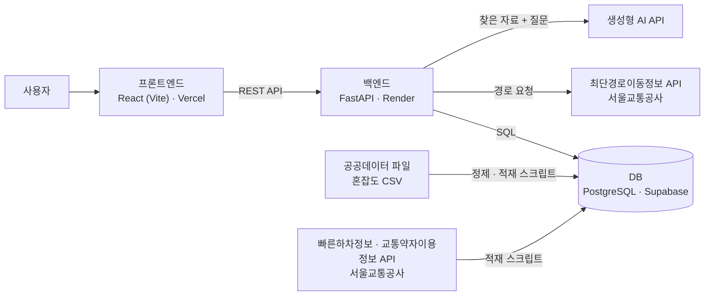

# 빨리 갈까, 편하게 갈까? (easy-nav)

몇 분 더 쓰면 얼마나 덜 붐빌까? 혼잡도까지 비교하는 서울 지하철 경로 추천 서비스

정보영재교수학습프로그램개발 · 인공지능기반 개발실습 팀 프로젝트

## 바로가기

| 구분 | 주소 |
|---|---|
| 서비스 웹 | https://easy-nav-iota.vercel.app |
| API (Swagger UI) | https://easy-nav-api.onrender.com/docs |
| API 설명 문서 | [backend/docs/API.md](backend/docs/API.md) |
| DB 테이블 문서 | [backend/docs/DB_TABLES.md](backend/docs/DB_TABLES.md) |

> API 서버는 무료 요금제라 15분 동안 요청이 없으면 잠듭니다. 처음 열 때 1분 정도 걸릴 수 있습니다.[cite: 2]
> 수업일(목요일) 저녁(18:00~22:50)에는 GitHub Actions(서버 깨우기)가 10분마다 서버를 불러 깨워 둡니다.

## 해결하려는 문제

지하철 앱은 가장 빠른 길과 환승이 적은 길을 알려 주지만, **그 길이 얼마나 붐비는지**는 알려 주지 않습니다. 출퇴근 시간에는 몇 분 더 걸리더라도 덜 붐비는 길을 고르고 싶은 사람이 많습니다. 이 서비스는 경로의 소요 시간과 혼잡도를 함께 보여 주고, 고르는 것은 사용자에게 맡깁니다.

## 주요 기능

| 기능 | 상태 |
|---|---|
| 역 검색 | API 완료 |
| 경로의 구간별 혼잡도와 평균·최대 혼잡도 (5단계) | API 완료 |
| 혼잡 구간 순위, 역 × 시간대 히트맵 (분석용) | API 완료 |
| 데이터 분석 페이지 (데이터 소개, 히트맵, 혼잡 순위) | 완료 |
| 빠른 길 vs 편한 길 비교 (후보 경로 최대 3개, 시간 가중치 점수) | 완료 |
| 출발 시각 비교 (앞뒤 1시간, 30분 간격) | 완료 |
| AI 안내 도우미 근거 자료 찾기 (빠른하차정보·교통약자이용정보) | API 완료 |
| AI 안내 도우미 답변 (찾은 자료로만 답하는 RAG) | 완료 |
| AI 길잡이 (고른 경로의 출발·환승·도착역 안내를 한 번에 모으는 RAG) | 완료 |
| 이용 규정 도우미 (여객운송약관 조항을 찾아 답하는 RAG) | 시범 |

혼잡도는 퍼센트 대신 5단계로 보여 줍니다.

| 단계 | 이름 | 혼잡도 |
|---|---|---|
| 1 | 여유 | 34% 이하 (좌석이 모두 차는 수준까지) |
| 2 | 보통 | 35~60% |
| 3 | 약간 붐빔 | 61~90% |
| 4 | 혼잡 | 91~120% |
| 5 | 매우 혼잡 | 121% 이상 |

## 서비스 아키텍처



1. 혼잡도 CSV를 정제해 DB에 미리 넣어 둡니다.
2. 사용자가 출발역·도착역·시각을 넣으면 서버가 최단경로 API로 경로를 받습니다. 같은 조건의 응답은 DB에 저장해 다시 씁니다.
3. 서버가 경로의 구간마다 그 시각의 혼잡도를 DB에서 찾아 평균과 최댓값을 계산하고 5단계로 바꿔 돌려줍니다.
4. 붐비는 역을 피한 돌아가는 경로도 받아, 시간과 혼잡도에 가중치를 둔 점수로 후보를 비교합니다.
5. 안내 도우미는 질문에 맞는 자료를 DB에서 먼저 찾고(Retrieval), 그 자료만 AI에게 넘겨 답을 만듭니다(Generation). 자료가 없으면 AI를 부르지 않고 못 찾았다고 답합니다.
6. AI 길잡이는 고른 경로의 출발·환승·도착역 자료를 한꺼번에 모아 역마다 한 줄씩 안내합니다. AI 문장의 숫자(칸·출입구)가 자료에 없으면 서버가 그 문장을 버리고 자료 원문을 보여 줍니다.
7. 이용 규정 도우미는 긴 문서(여객운송약관)를 조항마다 나눠 두고, 질문과 두 글자 조각이 가장 많이 겹치는 조항 3개를 찾아 그 조항으로만 답합니다. 답의 숫자와 조항 번호가 찾은 조항과 맞지 않으면 조항 원문을 보여 줍니다.

## 사용 데이터와 출처

| 데이터 | 제공 기관 | 형태 | 기준일 | 출처 |
|---|---|---|---|---|
| 지하철혼잡도정보 | 서울교통공사 | CSV | 2026-06-30 | https://www.data.go.kr/data/15071311/fileData.do |
| 최단경로이동정보 | 서울교통공사 | Open API | 호출 시점 | https://www.data.go.kr/data/15143842/openapi.do |
| 빠른하차정보 | 서울교통공사 | Open API | 적재 시점 | https://www.data.go.kr/data/15143840/openapi.do |
| 교통약자이용정보 (엘리베이터) | 서울교통공사 | Open API | 적재 시점 | https://www.data.go.kr/data/15143843/openapi.do |
| 여객운송약관 (1~8호선) | 서울교통공사 | 웹 문서 (복사해 backend/data/terms.txt로 저장) | 파일 첫 줄의 기준일 | http://www.seoulmetro.co.kr/kr/page.do?menuIdx=528 |

혼잡도는 정원 대비 승차 인원(%)으로, 승객 수와 좌석 수가 같을 때가 34%입니다. 실시간 값이 아닌 분기 평균 통계입니다.

## 데이터 정제

| 처리 | 이유 |
|---|---|
| 옆으로 펼쳐진 30분 단위 39칸을 세로로 풀기 (1,671행 → 65,169행) | 역·요일·방향·시간대 하나를 한 줄로 저장하고 찾기 위해 |
| 숫자 뒤 공백 제거, 숫자로 변환 | 원본 값에 공백이 섞여 있음 |
| 혼잡도 0인 3,693칸 제외 (DB에는 61,476행) | 첫차 전·막차 뒤·종점 방향처럼 열차가 다니지 않는 칸. 그대로 두면 "여유"로 잘못 보임 |
| API의 방향 표기(상행·하행)를 혼잡도 파일 표기(상선·하선)로 맞춤 | 두 자료의 표기가 다름 |
| 특수 역번호 맞춤 (예: 2호선 성수 외선 → 9001) | 혼잡도 파일 안에서 번호가 따로 매겨진 곳 |

## 폴더 구조

```
easy-nav/
├── frontend/          React 소개 사이트와 서비스 화면 (Vercel 배포)
│   ├── src/           화면 코드
│   └── public/        게임, 아이콘, 공유 미리보기 이미지
└── backend/           FastAPI 서버 (Render 배포)
    ├── main.py        API
    ├── route_logic.py 경로 계산 (후보 경로, 구간 혼잡도, 점수)
    ├── guide.py       AI 안내 도우미 (근거 자료 찾기, 찾은 자료로 답하기, 경로 길잡이)
    ├── terms.py       이용 규정 도우미 (약관 조항 나누기·찾기, 조항으로 답하기)
    ├── scripts/       데이터 정제·적재·확인 스크립트, 테이블 정의(schema.sql)
    └── docs/          API 설명 문서, DB 테이블 문서
```

## 내 컴퓨터에서 실행하기

```bash
# 화면
cd frontend
npm install
npm run dev

# 서버 (backend/.env에 PUBLIC_DATA_API_KEY, ROUTE_API_URL, DATABASE_URL, LLM_API_KEY 필요)
cd backend
python -m venv .venv
.venv\Scripts\activate
pip install -r requirements.txt
uvicorn main:app --reload      # http://127.0.0.1:8000/docs
```

인증키와 DB 접속 주소는 `.env`에만 두고 저장소에 올리지 않습니다.

## 팀 역할

| 역할 | 맡은 일 |
|---|---|
| 역할 1 | 기획 및 발표 |
| 역할 2 | 시스템 구현 |
| 역할 3 | 자료 조사 |
| 역할 4 | 사용성 검증 |
