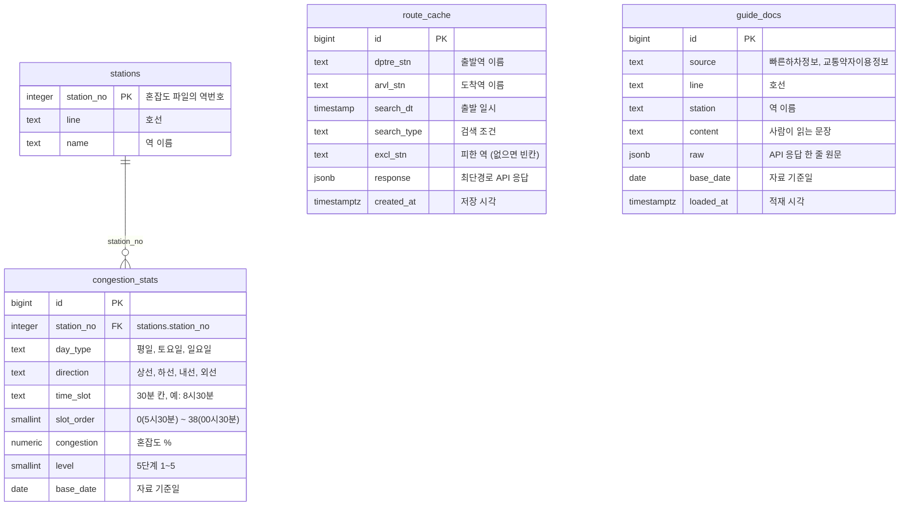

# easy-nav DB 테이블 문서

- DB: PostgreSQL (Supabase)
- 자료: 서울교통공사_지하철혼잡도정보 (2026-06-30 기준, 공공데이터포털)
- 자료: 서울교통공사_빠른하차정보, 서울교통공사_교통약자이용정보(엘리베이터) Open API (AI 안내 도우미의 근거 자료)
- 적재: `backend/scripts/load_db.py`(혼잡도), `backend/scripts/load_guide.py`(안내 도우미 자료) · 테이블 정의는 `backend/scripts/schema.sql`

## 테이블 관계

역 하나(stations)에 혼잡도 여러 줄(congestion_stats)이 붙는 1 : N 관계입니다. route_cache는 외부 API 응답을 저장하는 표, guide_docs는 안내 도우미의 근거 자료 표라 다른 표와 연결하지 않습니다.

## stations · 역 (282줄)

| 컬럼 | 형식 | 키 | 설명 |
|---|---|---|---|
| station_no | integer | 기본키 | 혼잡도 파일의 역번호. 최단경로 API의 역코드 `"0226"`에서 앞자리 0을 뗀 값과 같습니다. 9000번대는 지선·특수 승강장입니다. (예: 9001 성수E) |
| line | text | | 호선 (1~8호선) |
| name | text | | 역 이름 |

## congestion_stats · 혼잡도 통계 (61,476줄)

| 컬럼 | 형식 | 키 | 설명 |
|---|---|---|---|
| id | bigint | 기본키 | 자동 번호 |
| station_no | integer | 외래키 → stations.station_no | 역 |
| day_type | text | | 평일, 토요일, 일요일 |
| direction | text | | 상선, 하선, 내선, 외선 |
| time_slot | text | | 30분 칸 이름 (5시30분 ~ 00시30분, 39칸) |
| slot_order | smallint | | 시간 순서 정렬용 번호 (0 ~ 38) |
| congestion | numeric(5,1) | | 혼잡도 %. 정원 대비 승차 인원이며, 좌석이 모두 찼을 때가 34%. 0보다 큰 값만 저장 |
| level | smallint | | 5단계 (1 여유 ~ 5 매우 혼잡) |
| base_date | date | | 자료 기준일 2026-06-30 |

- 원본 65,169칸 중 혼잡도가 0인 3,693칸(5.7%)은 넣지 않았습니다. 첫차 전·막차 뒤·종점 방향처럼 그 시간에 열차가 다니지 않는 칸이라, 그대로 두면 "여유"(1단계)로 잘못 보이고 평균을 낮추기 때문입니다.
- 같은 역·요일·방향·시간대는 한 줄만 있습니다. (station_no, day_type, direction, time_slot 묶음이 유일)
- 시간대로 순위를 찾는 질의가 많아 (day_type, time_slot)에 색인을 둡니다.

## route_cache · 경로 응답 저장

| 컬럼 | 형식 | 키 | 설명 |
|---|---|---|---|
| id | bigint | 기본키 | 자동 번호 |
| dptre_stn | text | | 출발역 이름 |
| arvl_stn | text | | 도착역 이름 |
| search_dt | timestamp | | 출발 일시 |
| search_type | text | | 검색 조건 (duration = 최단시간) |
| excl_stn | text | | 피한 역 이름. 돌아가는 경로를 받을 때 최단경로 API에 넘긴 제외역(`exclTrfstns`)이고, 가장 빠른 경로는 빈칸 (워크북 6에서 추가) |
| response | jsonb | | 최단경로 API 응답 원문 |
| created_at | timestamptz | | 저장한 시각 |

- 같은 출발역·도착역·출발 일시·검색 조건·피한 역은 한 줄만 저장합니다. 같은 조건으로 다시 요청하면 API를 부르지 않고 저장된 응답을 씁니다. (하루 호출 한도 10,000건 대비)

## guide_docs · AI 안내 도우미 근거 자료

| 컬럼 | 형식 | 키 | 설명 |
|---|---|---|---|
| id | bigint | 기본키 | 자동 번호 |
| source | text | | 자료 이름: 빠른하차정보, 교통약자이용정보 |
| line | text | | 호선 |
| station | text | | 역 이름 (API의 stnNm) |
| content | text | | API 한 줄을 사람이 읽는 문장으로 바꾼 것. AI에게 이 문장을 근거로 넘깁니다 |
| raw | jsonb | | API 응답 한 줄 원문 |
| base_date | date | | 자료 기준일 (API의 crtrYmd) |
| loaded_at | timestamptz | | 적재한 시각 |

- `scripts/load_guide.py`가 두 API의 모든 쪽을 받아 표를 비우고 다시 채웁니다. 없어진 엘리베이터(oprtngSitu = D)는 넣지 않습니다.
- 역 이름으로 찾는 질의가 많아 station에 색인을 둡니다.
- 엘리베이터 가동 상태는 5분마다 바뀌는 값이라 문장에 넣지 않습니다.

## 혼잡도 5단계 기준

| 단계 | 이름 | 혼잡도 |
|---|---|---|
| 1 | 여유 | 34% 이하 |
| 2 | 보통 | 35~60% |
| 3 | 약간 붐빔 | 61~90% |
| 4 | 혼잡 | 91~120% |
| 5 | 매우 혼잡 | 121% 이상 |

## 보안

- 네 표 모두 Row Level Security를 켜서 Supabase 공개 주소(anon 키)로는 읽고 쓸 수 없습니다. 서버는 `DATABASE_URL`로 직접 접속합니다.
- 접속 주소와 비밀번호는 `backend/.env`와 Render 환경 변수에만 둡니다.
